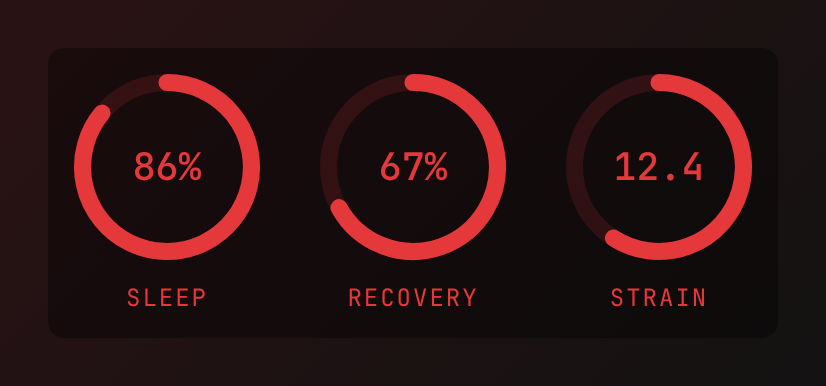
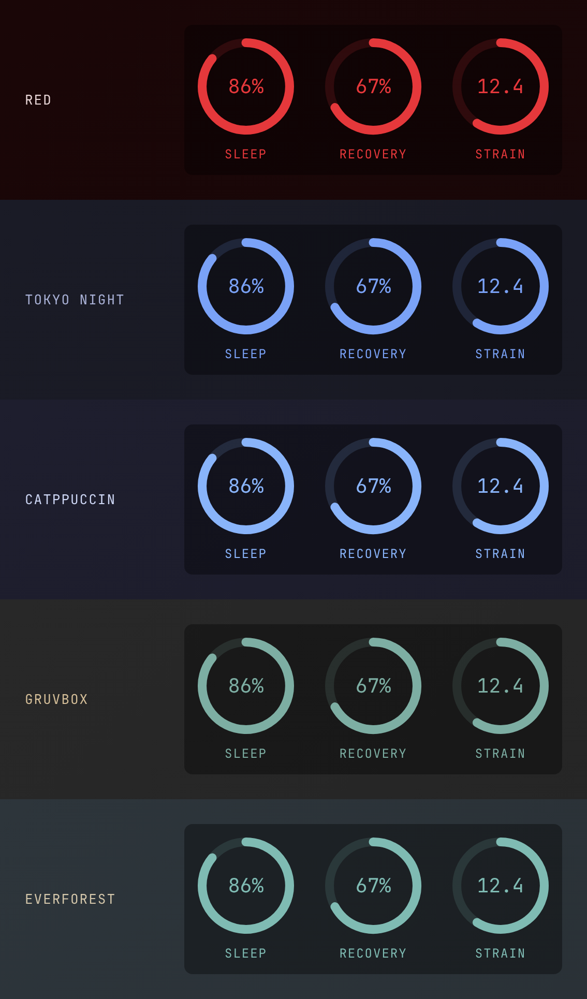
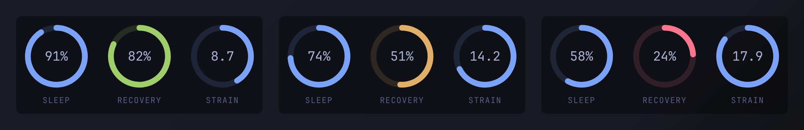

<div align="center">

# WHOOP Rings for Omarchy

**Your WHOOP Sleep, Recovery and Strain as rings on the desktop, in your system theme's colours.**

[](https://github.com/RuffBudda/OmaWhoop/actions/workflows/check.yml)
[](CHANGELOG.md)
[](LICENSE)
[](https://plugins.omarchy.org)
[](manifest.json)
<br>
[](Service.qml)
[](scripts)
[](https://developer.whoop.com)
[](https://github.com/RuffBudda/OmaWhoop/commits)



</div>

---

## Contents

- [Features](#features)
- [System colours](#system-colours)
- [Requirements](#requirements)
- [Install](#install)
- [Connect WHOOP](#connect-whoop)
- [Settings](#settings)
- [Updating and removing](#updating-and-removing)
- [How it works](#how-it-works)
- [Privacy and security](#privacy-and-security)
- [Troubleshooting](#troubleshooting)
- [Development](#development)
- [Changelog](#changelog) · [Contributing](#contributing) · [License](#license)

## Features

- **Three rings:** Sleep performance %, Recovery % and day Strain (0–21), from WHOOP's
  official v2 API.
- **System colours:** the rings use your Omarchy theme's colours and change the moment
  you run `omarchy theme set`. You can point any part at another theme colour or a hex
  value. See [System colours](#system-colours).
- **Recovery zones (optional):** colour the recovery ring green, yellow or red like the
  WHOOP app, using your theme's own green, yellow and red.
- **Out of your way:** it sits on the wallpaper behind your windows, clicks pass through
  it, it stays below the bar, and it keeps the same 12 px gap from the screen edge as
  Omarchy's default window gaps.
- **Quiet:** it refreshes every 15 minutes (you can change this) and is hidden until
  WHOOP is connected. A ring shows `–` until WHOOP has scored that day. If WHOOP or the
  network fails, it keeps the last data.
- **No extra dependencies:** QML for the widget, plus two Python 3 standard-library scripts.
- **Private:** your keys stay in `~/.config/whoop/` (mode 600) and only ever go to WHOOP.

## System colours

By default the rings, numbers and labels use your theme's **accent** colour on a
translucent black box. This is how it looks in some of Omarchy's built-in themes, with
no settings at all:



Any colour setting can take one of these:

| Value | Example | Where the colour comes from |
| --- | --- | --- |
| A theme role | `"accent"`, `"foreground"`, `"background"`, `"muted"`, `"urgent"` | The live shell theme (the same colours as the bar, menus and lock screen) |
| A `colors.toml` key | `"green"`, `"bright_blue"`, `"selection"`, `"color4"` | Any colour in the active theme's `colors.toml`. Dashes and underscores both work. |
| A hex colour | `"#7aa2f7"`, `"#cc7aa2f7"` | Fixed; doesn't change with the theme |

Theme colours are re-read whenever you switch themes, so a setting such as `"green"`
always means *the current theme's* green.

With `"recoveryZones": true`, the recovery ring follows WHOOP's zones (67–100 green,
34–66 yellow, 0–33 red) in the theme's colours. The example below is Tokyo Night with
`"value": "foreground"` and `"label": "muted"`:



<sub>Previews are drawn with sample values.</sub>

## Requirements

- [Omarchy](https://omarchy.org) with the Quickshell shell and its plugin system
  (`omarchy plugin …`). This is not a Waybar module.
- `python3` and `xdg-open`. Omarchy ships both.
- A WHOOP membership, plus a free WHOOP developer app (created in the next section).

## Install

```bash
omarchy plugin add https://github.com/RuffBudda/OmaWhoop.git --enable
```

Omarchy shows you the URL and asks before cloning; read the code first if you like.
You can also add it from the menu: **Setup → Plugins → Add**.

## Connect WHOOP

This is done once.

1. Open the [WHOOP developer dashboard](https://developer-dashboard.whoop.com) and sign
   in with your WHOOP account.
2. Create an app with:
   - **Redirect URI:** `http://localhost:8765/callback`
   - **Scopes:** `read:recovery`, `read:cycles`, `read:sleep`, `offline`
3. Run:

   ```bash
   ~/.config/omarchy/plugins/ruffbudda.whoop/scripts/whoop-auth
   ```

   Paste the app's **Client ID** and **Client Secret**. The secret isn't shown as you
   type it. Your browser opens WHOOP; approve it, and the rings appear a moment later.

To use a different WHOOP app, delete `~/.config/whoop/client.json` and run `whoop-auth` again.

## Settings

Shell services don't get settings in `shell.json`, so the widget reads
**`~/.config/whoop/widget.json`**. Every key is optional, and changes apply as soon as you
save the file; no restart is needed. To start from the example:

```bash
cp ~/.config/omarchy/plugins/ruffbudda.whoop/examples/widget.json ~/.config/whoop/widget.json
```

```json
{
  "corner": "top-left",
  "offsetX": 0,
  "offsetY": 0,
  "screen": "",
  "refreshMinutes": 15,
  "recoveryZones": true,
  "colors": {
    "ring": "accent",
    "value": "foreground",
    "label": "muted",
    "box": "background",
    "boxOpacity": 0.35,
    "trackOpacity": 0.15
  }
}
```

### Placement

| Key | Meaning | Default |
| --- | --- | --- |
| `corner` | `top-left`, `top-right`, `bottom-left` or `bottom-right` | `top-left` |
| `offsetX` / `offsetY` | Extra pixels away from the side and the top or bottom edge, e.g. to stack it with other desktop widgets | `0` |
| `screen` | Output name, e.g. `DP-1` (see `hyprctl monitors`) | The laptop panel if it's on, else the first screen |
| `refreshMinutes` | How often to fetch from WHOOP (minimum 5) | `15` |

### Colours

Every value under `colors` takes a theme role, a `colors.toml` key or a hex colour
(see [System colours](#system-colours)).

| Key | What it colours | Default |
| --- | --- | --- |
| `ring` | All three rings, and the numbers and labels unless they're set separately | `accent` |
| `sleep` / `recovery` / `strain` | One ring each; overrides `ring` and `recoveryZones` | `ring` |
| `value` | The numbers inside the rings | `ring` |
| `label` | The `SLEEP` / `RECOVERY` / `STRAIN` captions | `ring` |
| `box` | The box behind the rings | `#000000` |
| `boxOpacity` | The box's opacity, `0`–`1` | `0.35` |
| `trackOpacity` | The faint unfilled part of each ring, `0`–`1` | `0.15` |

| Key | Meaning | Default |
| --- | --- | --- |
| `recoveryZones` | Colour the recovery ring by WHOOP zone in the theme's green, yellow and red (WHOOP's own colours if the theme has none) | `false` |

As a shorthand, `"colors": "green"` sets every ring to the theme's green.

## Updating and removing

```bash
omarchy plugin update ruffbudda.whoop      # shows the diff, then fast-forwards
omarchy plugin remove ruffbudda.whoop
rm -rf ~/.config/whoop ~/.cache/whoop.json  # optional: forget your WHOOP keys, settings and data
```

You can also revoke the app's access in the WHOOP developer dashboard.

## How it works

```
          every 15 min                      writes                  watched
Service.qml ───────────▶ scripts/whoop-fetch ─────▶ ~/.cache/whoop.json ─────▶ rings
     ▲                         │  refreshes the token in ~/.config/whoop/tokens.json
     │ watched                 ▼
~/.config/whoop/widget.json    WHOOP API v2 (recovery, cycle, sleep)
```

| File | What it does |
| --- | --- |
| [`manifest.json`](manifest.json) | Declares a `service` plugin with `keepLoaded: true`. |
| [`Service.qml`](Service.qml) | Runs the fetcher on a timer, watches the cache, your settings and the theme's `colors.toml`, and draws the rings in a click-through layer-shell window on the `bottom` layer. |
| [`Colors.js`](Colors.js) | Reads the theme palette, resolves colour settings and works out recovery zones. |
| [`scripts/whoop-auth`](scripts/whoop-auth) | A one-time OAuth sign-in. It opens WHOOP in your browser, catches the reply on `127.0.0.1:8765`, checks the `state` value, and saves the tokens with mode 600. |
| [`scripts/whoop-fetch`](scripts/whoop-fetch) | Refreshes the access token when it expires, reads the latest *scored* recovery, cycle and sleep, and writes the cache atomically. |
| [`examples/widget.json`](examples/widget.json) | An example settings file. |
| [`tools/check`](tools/check) | The checks CI runs (see [Development](#development)). |

`whoop-fetch` exit codes: `0` ok, `1` WHOOP or the network failed (the last data is kept),
`2` WHOOP isn't connected yet. Both scripts honour `XDG_CONFIG_HOME` and `XDG_CACHE_HOME`.

The cache file looks like this:

```json
{"recovery": 67, "strain": 12.4, "sleep": 86, "updated": "2026-11-07T08:15:00+00:00"}
```

## Privacy and security

- Your Client ID, Client Secret and tokens are stored only in `~/.config/whoop/`, with
  the folder at mode 700 and the files at mode 600. They are never written to the
  plugin folder or the cache.
- The only network traffic is to `api.prod.whoop.com`.
- The sign-in server listens on `127.0.0.1` only, handles a single request, and checks a
  random `state` value against forged replies.
- Like every Omarchy plugin, this runs unsandboxed inside your shell. The code is short;
  please read it.

See [SECURITY.md](SECURITY.md) to report a problem privately.

## Troubleshooting

| Symptom | Fix |
| --- | --- |
| No rings at all | WHOOP isn't connected (run `whoop-auth`) or nothing is scored yet. Run `whoop-fetch` by hand (below). |
| A ring shows `–` | WHOOP hasn't scored that metric yet today (e.g. sleep is still processing). |
| `error 1010` / 403 | Cloudflare blocked the request. The scripts already send their own User-Agent; try again in a few minutes. |
| "sign-in may have expired" | Run `whoop-auth` again. |
| `whoop-auth` can't start | Something else is using port 8765. Close it and retry. The redirect URI must match your WHOOP app exactly. |
| Wrong colours after a theme switch | Save `widget.json` again, or run `omarchy restart shell`. |
| Widget covers another widget | Set `offsetX` / `offsetY` or `corner`. |

```bash
~/.config/omarchy/plugins/ruffbudda.whoop/scripts/whoop-fetch; echo "exit $?"
cat ~/.cache/whoop.json
quickshell log --any-display -p /usr/share/omarchy/shell -t 80   # shell errors
```

## Development

```bash
git clone https://github.com/RuffBudda/OmaWhoop.git
cd OmaWhoop
tools/check                                    # manifest, scripts, colour tests, QML syntax
omarchy plugin validate .                      # Omarchy's own validator
ln -s "$PWD" ~/.config/omarchy/plugins/ruffbudda.whoop && omarchy plugin enable ruffbudda.whoop
```

Saving a file under `~/.config/omarchy/plugins/` reloads plugin code automatically. This
plugin is `keepLoaded`, so run `omarchy restart shell` to pick up changes to `Service.qml`.
`tools/check` needs `jq`, `node` and `python3`, and `qmlformat` (Qt 6) for the QML check.

## Changelog

See [CHANGELOG.md](CHANGELOG.md).

## Contributing

Issues and pull requests are welcome; see [CONTRIBUTING.md](CONTRIBUTING.md).

## License

[MIT](LICENSE) © 2026 RuffBudda

Originally built for the [DictatorOS](https://github.com/RuffBudda/DictatorOS) Omarchy setup.
Omarchy is by David Heinemeier Hansson and contributors (MIT).

*This project is not affiliated with, endorsed by or sponsored by WHOOP, Inc. WHOOP is a
trademark of WHOOP, Inc. Data is fetched with your own developer app under the
[WHOOP API terms](https://developer.whoop.com).*
